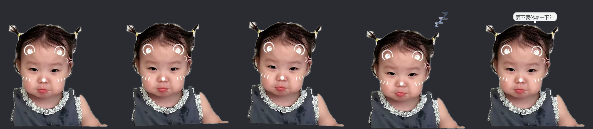

# 小面宝宝桌宠 🍼

用宝宝照片做的 Windows 桌面宠物。**只在 DSH Desktop 运行时出现**，关掉就自动躲起来。

当前版本：**pet-v1.2**



（从上到下：待机呼吸 / 跟手右倾 / 跟手左倾 / 睡觉 Zzz / 说话气泡）

---

## 怎么用

**首次**：双击 `install_autostart.bat` 一次 —— 它会把守护进程加进开机自启，并立即启动。
之后每次开机自动运行，打开 DSH 桌宠就出现，关掉 DSH 就退出，完全不用管。

**手动启动**（不想装开机自启时）：双击 `start_pet.vbs`，不弹黑框。
它启动的是**守护进程**（无窗口、常驻约 16 MB）：检测到你打开 DSH 就把桌宠拉起来，
DSH 关掉桌宠就**彻底退出**，不留后台驻留进程。

| 操作 | 效果 |
|---|---|
| 鼠标移动 | 头身会朝鼠标方向轻微偏移 + 倾斜（跟手） |
| 按住拖动 | 拖到屏幕任意位置，松手有果冻弹性回弹，位置自动记住 |
| 单击 | 蹦一下 + 冒一句随机台词 |
| 双击 | 睡觉 / 叫醒（睡觉时下沉压扁 + 冒 Zzz） |
| 右键 | 菜单：说句话 / 睡觉 / 回到右下角 / 隐身 10 分钟 / 退出 |

透明区域鼠标会穿透过去，不会挡住你点下面的窗口。

**只在我打开时出现**：桌宠每 0.5 秒检测一次 `DSH Desktop` 进程。
DSH 一关闭，它就**直接退出**（不是隐藏、不在后台留驻）。下次你打开 DSH，由守护进程
`watchdog.py` 在 1.5 秒内把它重新拉起来。想让它一直显示、不跟 DSH 绑定，用
`python pet.py --force` 启动。

**调大小**：改 `config.json` 里的 `height`（默认 220，逻辑像素，实际会再乘屏幕 DPI 缩放），重启桌宠生效。

---

## 文件说明

```
pet/
├─ pet.py                  桌宠主程序（纯 ctypes + Pillow，约 600 行）
├─ watchdog.py             守护进程：DSH 出现就拉起桌宠，DSH 关闭桌宠退出
├─ start_pet.vbs           无黑框启动器（启动守护进程）
├─ install_autostart.bat   双击一次：装开机自启 + 立即启动（调 tools/install_autostart.ps1）
├─ config.json             显示高度等设置
├─ state.json              记住的位置（自动生成，不进版本库）
├─ pet.log / watchdog.log  出错日志（自动生成）
├─ pet.pid / watchdog.pid  进程号，用于互相判断存活（自动生成）
├─ assets/
│  ├─ xiaomian.png         抠好的立绘 799×666 透明 PNG（主素材，含两只手臂）
│  ├─ xiaomian-320h.png    桌宠运行时真正加载的尺寸
│  └─ raw/                 原图（未抠，抠图脚本的输入）
├─ tools/
│  ├─ cutout.py            抠图脚本（可重复运行，参数在文件头）
│  ├─ finalize.py          生成主素材与运行尺寸（中间产物缺失会自动重抠）
│  ├─ install_autostart.ps1 安装开机自启的实际逻辑
│  └─ fetch_wheels.mjs     从镜像下载 wheel（本机 pip 装不了包时的绕路方案）
└─ .pylibs/                Pillow 本体（不进版本库）
```

---

## 技术要点

**透明窗口**：没用 tkinter 的 `-transparentcolor` 色键（会留锯齿白边），而是纯 ctypes 调
`UpdateLayeredWindow` 做逐像素 alpha 的分层窗口，边缘是真正半透明。鼠标经过 alpha<24 的
像素时 `WM_NCHITTEST` 返回 `HTTRANSPARENT`，点击穿透到下层窗口。

**只动整张图**：只有一张正面照，所以除 Zzz 和气泡外所有动效都是整张立绘的位移/旋转/纵向缩放
（呼吸、跟手倾斜、拖拽弹性、睡觉下沉压扁）。果冻回弹用阻尼弹簧：`a = k(目标-当前) - c·v`，
`k=130, c=12`。

**性能**：单帧渲染 1–3 ms（220px 高），定时器 16 ms 一帧，占用很低（约 57 MB 内存）。

**和 DSH 的生命周期绑定**：两个进程分工 —— `watchdog.py` 常驻（无窗口、约 16 MB），每 1.5 秒
查一次 `DSH Desktop` 是否在运行：在运行而桌宠不在，就把桌宠拉起；桌宠自己每 0.5 秒查一次，
DSH 一消失就 `PostQuitMessage` 退出（见过 DSH 之后是立即退出；启动时的 20 秒宽限只用于覆盖
"和 DSH 同时被拉起"的竞态）。守护进程还有 6 秒兜底：桌宠没自己走就强杀。两者靠 `pet.pid` /
`watchdog.pid` + `OpenProcess` 判断对方存活，守护进程用 pid 文件保证只有一个实例。

**抠图**：不用 AI 模型，纯 Pillow 手写流程，两个判据叠加 ——
① **颜色**：背景是"亮 + 中性 + 不偏红"，皮肤偏红、头发/深裙很暗，都能排除；
② **纹理**：白荷叶边和白椅背颜色完全重叠，但荷叶边有褶皱、局部方差高（实测 365~2010），
椅背平滑（方差≈0），所以"高纹理"也算主体。细节与实测数据见 `tools/cutout.py` 文件头注释。

> **坑 1：不能按连通块整块丢弃**。左边手臂和左边黑色车把手在二值图里**连成一整块**（手臂搭在
> 车把前面），"质心太靠边就丢"的规则会把手臂一起丢掉。必须先按颜色（近乎纯黑的中性色 + 位于
> 外侧下方）在像素层面挖掉车把，再清掉车把包围盒内的非皮肤残留，手臂才留得下来。
>
> **坑 2：白荷叶边会被当成背景吃掉**。早期靠大核闭运算把断缝"补"回来，结果把手/手臂旁边的
> 椅背白区也糊进轮廓（白色凹口）、肩部还会留透明缝。改用纹理方差判据后，荷叶边本来就是主体，
> 手臂和身体天然连通，不再需要大核闭运算。
>
> **坑 3：小尺寸下有一圈白边**。羽化把半透明环放在了白色背景上，反解颜色也救不回来（那里本来
> 就没有主体）。所以羽化前先收缩 2px，再把半透明像素里混入的背景色按
> `observed = a·fg + (1-a)·bg` 反解掉。


---

## 换一张照片

1. 把新照片放进 `assets/raw/`
2. 改 `tools/cutout.py` 开头的 `SRC`，按需调 `LUM_MIN / CHROMA_MAX / REDNESS_MAX / VAR_THRESHOLD`
3. 跑 `python tools/cutout.py`，看 `debug/checker.png` 是否满意
4. 跑 `python tools/finalize.py` 生成主素材与运行尺寸
5. `python pet.py --preview` 出状态对比图

---

## 环境说明

这台机器上 `pip` 装不了包（Python 装在 `D:\python`，沙箱禁止写入；解包时还会 `Permission denied`），
所以 Pillow 是手动下载 wheel 解压到 `.pylibs` 的，`pet.py` 启动时自己把该目录加进 `sys.path`。
换台机器可以直接 `pip install pillow`，然后把 `.pylibs` 删掉。


